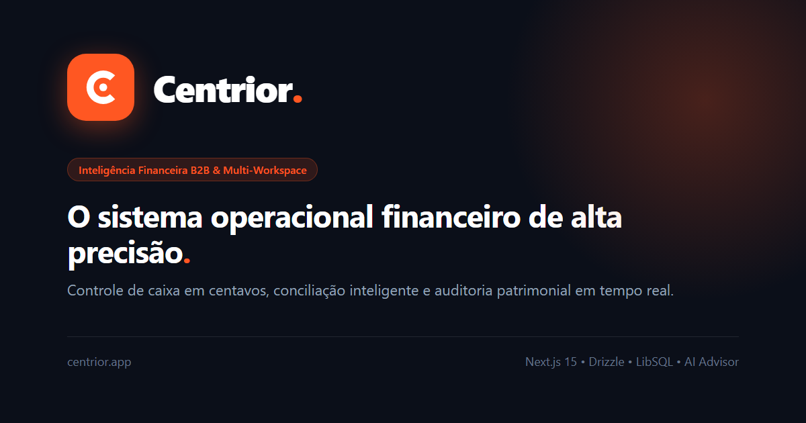
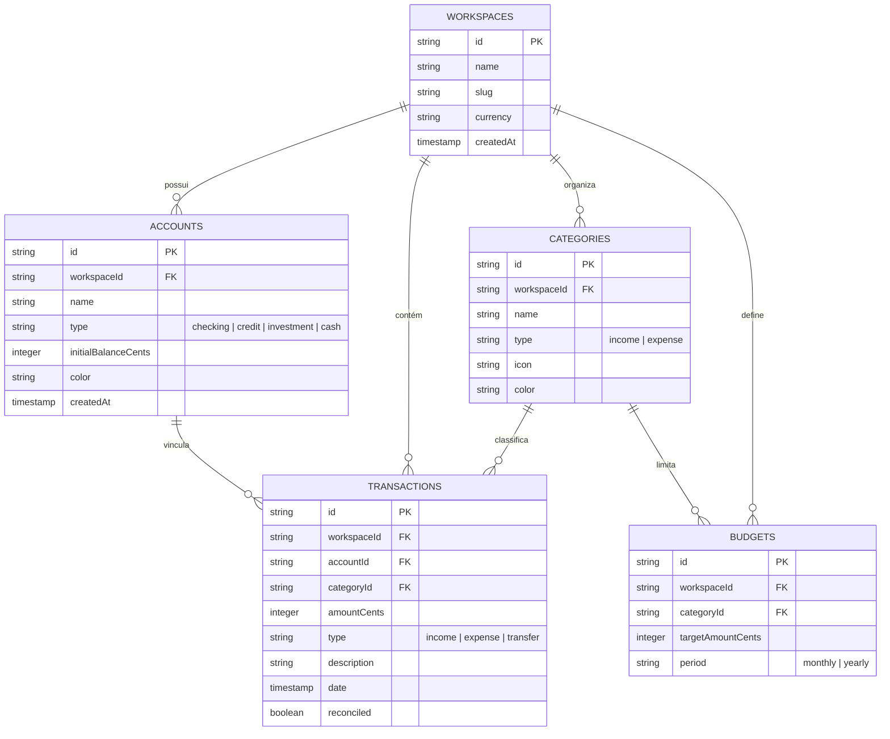

<div align="center">



# ⚡ Centrior
### Plataforma de Inteligência Financeira e Conciliação de Alta Precisão

[](https://nextjs.org/)
[](https://react.dev/)
[](https://tailwindcss.com/)
[](https://www.typescriptlang.org/)
[](https://orm.drizzle.team/)
[](https://turso.tech/)
[](https://playwright.dev/)
[](#-privacidade--lgpd)

<p align="center">
  <b>Controle financeiro de nível institucional com precisão sub-centavo, conciliação inteligente de extratos, auditoria automatizada e IA consultiva integrada.</b>
</p>

[Visão Geral](#-visão-geral) • [Diferenciais](#-diferenciais-e-recursos) • [Arquitetura](#-arquitetura--adrs) • [Modelo de Dados](#-modelo-de-dados) • [Como Executar](#-como-executar) • [Testes](#-suíte-de-testes) • [Licença](#-licença)

</div>

---

## 📌 Visão Geral

O **Centrior** é uma solução completa de inteligência e controle financeiro projetada para indivíduos e negócios que exigem **precisão contábil matemática**, **latência sub-100ms** e uma experiência de usuário limpa, moderna e responsiva.

Construído sob o ecossistema de ponta (**Next.js 15**, **React 19**, **Tailwind CSS v4** e **Drizzle ORM**), a plataforma substitui interfaces bancárias lentas e planilhas sujeitas a erros por um painel unificado com importação de extratos OFX/CSV, categorização preditiva, gestão orçamentária e consultoria financeira com IA.

---

## ✨ Diferenciais e Recursos

### 🎯 Precisão Matemática em Centavos
- Eliminação completa de anomalias de arredondamento de ponto flutuante IEEE 754.
- Todos os montantes são transacionados e persistidos como **inteiros em centavos** (`amountCents: integer`), garantindo consistência bancária estrita.

### ⚡ Extrato Virtualizado de Alta Escala
- Renderização com **`@tanstack/react-virtual`**: capacidade de navegar por dezenas de milhares de lançamentos financeiros sem perda de quadros (60 FPS) e com consumo mínimo de memória no cliente.

### 🤖 Centrior AI Advisor
- Assistente financeiro contextual que analisa receitas, despesas fixas/variáveis, fluxo de caixa e taxa de queima (*runway*).
- Insights acionáveis para otimização tributária, corte de desperdícios e projeção de metas.

### 📥 Importação e Conciliação Inteligente
- Suporte nativo para leitura e processamento de arquivos **OFX** (bancos tradicionais e digitais) e planilhas **CSV**.
- Deduplicação inteligente de lançamentos idênticos e pré-categorização contextual de transações.

### 💼 Multi-Workspace & Gestão Orçamentária
- Alternância instantânea entre carteiras pessoais, empresas ou projetos paralelos.
- Estabelecimento de tetos orçamentários dinâmicos com alertas visuais de proximidade de limite.

### 🚀 Modo "1-Click Recrutador" (`/api/demo/reset`)
- Endpoint dedicado que reseta o estado da aplicação e injeta uma base de dados realista (múltiplas contas, cartões de crédito, categorias e histórico transacional variado) com apenas 1 clique.

---

## 🏛️ Arquitetura & Decisões Técnicas (ADRs)

| Decisão | Solução Adotada | Justificativa |
| :--- | :--- | :--- |
| **Framework Full-Stack** | Next.js 15 (App Router) + React 19 | Server Components para SSR ultra-rápido, Server Actions tipadas e streaming progressivo. |
| **Estilização & Design** | Tailwind CSS v4 + Radix UI Primitives | CSS tokenizado com a nova engine v4, acessibilidade WCAG 2.2 AA nativa e design system centrado em *Flame Orange* (`#FF5722`). |
| **Camada de Dados & ORM** | Drizzle ORM + LibSQL (`@libsql/client`) | Schemas 100% tipados em TypeScript, zero overhead de runtime e portabilidade entre SQLite local e Turso Cloud Serverless. |
| **Virtualização de Listas** | TanStack Virtual v3 | Desempenho sustentado de rolagem em extratos extensos com reciclagem de nós no DOM. |
| **Visualização de Dados** | Recharts + CSS Custom Properties | Gráficos responsivos de pizza, barras e fluxo com suporte nativo a temas Light/Dark. |
| **Segurança & Resiliência** | Zod Schema Validation | Sanitização e validação de todas as entradas de dados na borda (Edge/Node). |

---

## 📊 Modelo de Dados

O banco de dados relacional foi modelado visando integridade referencial, conciliação e alta velocidade de consulta:



---

## 📁 Estrutura de Diretórios

```
centrior/
├── brand/                    # Ativos vetoriais master oficiais (símbolo e lockup horizontal)
├── drizzle/                  # Migrações geradas pelo Drizzle Kit
├── public/                   # Favicons, Web App Manifest e banner OpenGraph (1200x630)
├── src/
│   ├── app/                  # Rotas do Next.js App Router
│   │   ├── (dashboard)/      # Páginas do sistema (dashboard, extrato, contas, configurações, LGPD)
│   │   ├── api/              # Endpoints REST (demo reset, transações, importadores)
│   │   ├── layout.tsx        # Layout raiz com metadados SEO e OpenGraph
│   │   ├── manifest.ts       # PWA Web Manifest dinâmico
│   │   └── sitemap.ts        # Sitemap indexável
│   ├── components/           # Componentes modulares
│   │   ├── analytics/        # Métricas, gráficos e KPIs
│   │   ├── brand/            # Componente CentriorLogo vetorial multi-variante
│   │   ├── dashboard/        # Centrior AI Advisor, resumos e cards de saldo
│   │   ├── layout/           # Sidebar responsiva, TopNavBar e rodapé institucional
│   │   ├── transactions/     # Tabela virtualizada, modal de criação e filtros
│   │   └── ui/               # Primitivos UI baseados em Radix (Button, Dialog, Badge, Input)
│   ├── db/                   # Configuração do LibSQL, Schema tipado, queries e seeder
│   ├── features/             # Módulos de domínio (análise preditiva, parsers de arquivos)
│   └── lib/                  # Utilitários de moeda (BRL/USD), data-fns e classes CSS
└── tests/                    # Suíte de testes E2E com Playwright
```

---

## 🛠️ Como Executar

### Pré-requisitos
- **Node.js**: v18.18+ (recomendado v20 LTS ou superior)
- **npm** (ou **pnpm** / **yarn**)

### 1. Clonar o Repositório
```bash
git clone https://github.com/molz3ra/centrior.git
cd centrior
```

### 2. Instalar Dependências
```bash
npm install
```

### 3. Configurar Variáveis de Ambiente
Copie o modelo de variáveis de ambiente:
```bash
cp .env.example .env.local
```

> **Nota:** Por padrão, o projeto opera de forma autônoma com banco SQLite local (`file:local.db`). Caso deseje conectar a uma base distribuída no **Turso**, basta preencher `DATABASE_URL` e `DATABASE_AUTH_TOKEN`.

### 4. Inicializar o Banco de Dados & Popular Dados Iniciais
```bash
# Aplica os schemas no banco
npm run db:push

# Popula o banco com dados de exemplo (contas, categorias, transações)
npm run db:seed
```

### 5. Iniciar o Servidor de Desenvolvimento
```bash
npm run dev
```
Acesse [http://localhost:3000](http://localhost:3000) no seu navegador.

---

## 🧪 Suíte de Testes

A estabilidade da aplicação é assegurada por testes ponta a ponta (**Playwright**) e testes unitários (**Vitest**):

```bash
# Executar testes unitários e de lógica
npm run test

# Executar a suíte completa de testes E2E (com auto-servidor)
npm run test:e2e
```

Todos os fluxos críticos são cobertos por testes automatizados:
- ✅ **Acessibilidade e Navegação**: Carregamento instantâneo do dashboard e páginas institucionais.
- ✅ **Conformidade LGPD**: Validação do banner de cookies, persistência de consentimento e link para a Política de Privacidade.
- ✅ **Renderização e Responsividade**: Validação da Sidebar móvel, TopNavBar e componentes interativos.
- ✅ **Reset de Demonstração**: Validação de integridade do endpoint `/api/demo/reset`.

---

## 🛡️ Privacidade & LGPD

O Centrior foi construído aderente aos princípios da Lei Geral de Proteção de Dados (Lei nº 13.709/2018):
- **Minimização de Coleta**: Coleta estrita apenas dos dados essenciais para o cálculo financeiro.
- **Transparência de Consentimento**: Banner interativo de consentimento com aceite granual e armazenamento seguro no navegador.
- **Portabilidade & Direito ao Esquecimento**: Facilidade para expurgo ou exportação dos registros do workspace.

---

## 📄 Licença

Distribuído sob a licença **MIT**. Consulte o arquivo `LICENSE` para obter mais detalhes.

---

<div align="center">
  <sub>Desenvolvido com excelência técnica por <b>molz3ra</b>. Centrior © 2026. Todos os direitos reservados.</sub>
</div>
